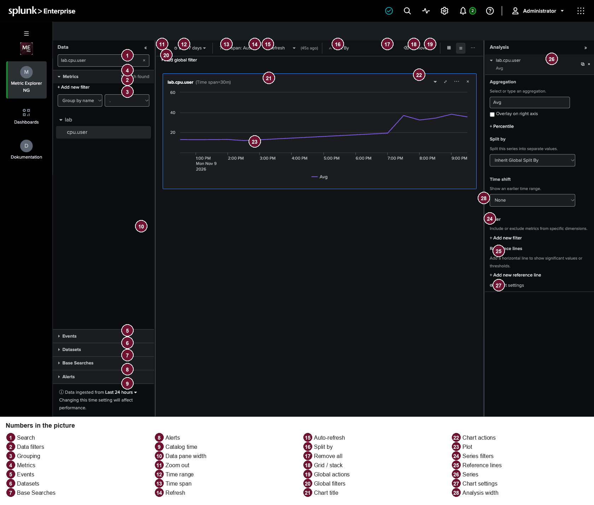

# Metric Explorer NG

  

Browse Splunk metric indexes and chart them without writing SPL.

Splunk removes the Analytics Workspace in Splunk Enterprise 10.6 and Splunk Cloud Platform 10.6 and does not ship a replacement. Metric Explorer NG is the app I built so that work still has a place: open a metric, see the chart, split it, filter it, and save it. The app covers the Analytics Workspace 2.56.0 functions and keeps a few additions that were already useful in daily work: events, datasets, base searches, named workspaces, the full `mstats` aggregations, and a global time span.

The current package is [1.1.0](https://github.com/hgehrts/metrics-explorer/releases/latest). Install `metrics_explorer-1.1.0.tar.gz` from **Apps > Manage Apps > Install app from file**, then restart Splunk. The app id is `metrics_explorer`. It runs on Splunk Enterprise 10.4 and 10.6. In the app, the same documentation is available in English and, on a `de-DE` Splunk URL, in German.

## Documentation

The numbers in the picture match the sections below.

### Data, left column

The column lists what can be charted. It filters the list, not the points of a chart that is already drawn.

#### 1. Search

- Filters metrics, events, datasets, base searches, and alerts by the text you type.
- Matches in the name are marked. A folder that contains a match is expanded.
- The cross clears the text.

#### 2. Data filters

- Limit which metrics and sourcetypes appear in the list.
- A new filter asks for the field, the mode, and the values. Index and other fields are available.
- The cross on a filter removes it. Reset to defaults restores the filters from the app configuration.
- These filters go into the catalog search. Filters for the drawn values are under Global filters and in Analysis.

#### 3. Grouping

- Group by orders the metric tree by metric name, by index, or by a dimension.
- The separator splits the name into folders at that character. A dot gives the usual `a.b.c` hierarchy.
- A click on a folder expands or collapses it.

#### 4. Metrics

- A click on the name creates a new chart and selects it.
- The icon to the right adds the metric to the selected chart instead of opening a new one.
- The list comes from the metric catalog for the catalog time range. If entries are missing, a note under the list says that only the first `max_metrics` were loaded.
- Host, source, and sourcetype are offered as dimensions even when the catalog does not list them.

#### 5. Events

- Lists sourcetypes in the catalog time range.
- A click opens an event chart. The search runs with `tstats`, not `mstats`.
- Analysis is where you pick the field to aggregate. `exactperc` is available here. `rate_avg` and `rate_sum` are not.

#### 6. Datasets

- Lists data models.
- A click opens a chart on that data model, also through `tstats`.

#### 7. Base searches

- Lists base searches saved in this app.
- A click opens a chart on that search.
- New base searches are created with Save as base search in a chart's menu.

#### 8. Alerts

- Lists alerts in this app.
- Show triggered instances opens the triggered instances in Splunk.

#### 9. Catalog time range

- Sets the window the catalog uses to find metrics and sourcetypes.
- This is not the time range of the charts. That control is the bar in the center.
- A longer window finds more names and takes longer. The note about that sits on the menu.

#### 10. Column width

- The line between Data and the charts moves the column. The center gets narrower or wider to match.
- Drag with the mouse. Left and right arrow move it 16 pixels, Shift moves it 48.
- The column can collapse to a narrow rail. Show data opens it again.
- The width applies to the current view and is not stored with the workspace.

### Bar above the charts

#### 11. Zoom out

- On a time chart, drag a window across the plot to zoom. Categorical charts and the heatmap do not zoom.
- The zoom applies to every chart. Zoom out clears it.
- While zoomed, Refresh and auto-refresh are off.

#### 12. Time range

- The search window of the charts. Presets, or your own start and end.
- Changing the time range clears a zoom.
- With Auto, the time span is chosen from this window so a series stays under about 1,000 points.

#### 13. Time span

- Auto lets each chart derive the span from the time range, including while zoomed.
- A chosen span applies to every chart whose own span is Auto.
- The span in a chart's settings wins over the bar.
- Categorical charts ignore the span. They collapse the whole time range into one value.
- Custom span: count and unit, then Apply span. Seconds, minutes, hours, and days are allowed, for example `30s` or `1d`.
- If the span is so fine that more than about 1,000 points would be drawn, a note offers a button that widens the span. If the chart span is set, the button changes that span. Otherwise it changes the span in the bar.

#### 14. Refresh

- Runs the chart searches again.
- The button is off when there is no chart or while zoomed. The note beside it says when the data was last loaded.

#### 15. Auto-refresh

- On or off. On means reload about every 10 seconds.
- The switch is off while zoomed.

#### 16. Split by

- Opens the global split: dimension, direction (highest or lowest values), and count. The default is the highest 5 values.
- With no metric in the active chart, the dimension list is empty.
- One metric lists that metric's dimensions. Several metrics in the same chart list only the dimensions every one of them has.
- It applies to metric series that inherit the global split, and only on charts where Use global split by for this chart is on. That is the default.
- Events and datasets do not inherit this dimension. A metric dimension does not exist there, and the search would return no rows.
- A dimension set on the series replaces the global one.
- The cross next to the button clears the global split.

#### 17. Remove all

- Removes every chart and the zoom.

#### 18. Grid and stack

- Grid places the charts side by side. Stack puts them in one column.
- The chosen layout is stored with the session.

#### 19. Global actions

- Save all charts to Classic Dashboards writes each chart as a panel on a Classic dashboard, new or existing, in this app.
- Save all charts to Dashboard Studio does the same for Dashboard Studio. The layout there is absolute or grid.
- Workspaces saves the current session under a name or opens a saved one. Saved are the charts, time range, catalog time range, global split, global filters, and the span from the bar. Column widths are not saved.
- The running session is also kept in the browser and restored the next time you open the page.

#### 20. Global filters

- Sit under the bar once a chart or a filter exists.
- Dimension, include or exclude, values. They apply to every chart whose series has that dimension.
- The cross removes a filter.

### Chart

#### 21. Title

- Shows the metric names of the series. With four or more name parts, the first stays, then `<...>`, then the last. Shorter names stay whole.
- Hover and the accessible name show the full name. PNG export uses the full title.
- Time charts also show the effective span, for example `(Time span=30s)`.
- A click on the card selects the chart. Analysis on the right belongs to that selection.

#### 22. Chart actions

- Arrow: collapse the chart or expand it again. The title stays.
- Four arrows: give the chart the tall height, or restore it.
- Three dots:
- Open in Search opens the chart's SPL in a new search.
- Clone this panel copies the chart.
- Search related events opens an event search for the time range and the filters.
- Save as scheduled alert and Save as streaming alert.
- Save to Classic Dashboards and Save to Dashboard Studio write this one chart.
- Save as report and Save as base search.
- Export as PNG for line, area, and column charts. The heatmap has no PNG export.
- Export as CSV writes the drawn values or, when the table is visible, the table.
- The cross removes the chart.

#### 23. Plot

- Time charts: line, area, column, stacked column, heatmap.
- Categorical charts: one column, or stacked columns, per series or split value, across the whole time range.
- A second axis appears when a series has Overlay on right axis turned on.
- The legend names the aggregation and, with a split, the values.
- Axis numbers are abbreviated while that setting is on. The tooltip uses the chosen decimal places.
- Loading… during the first search, Refreshing… when values are already shown and a reload is running. No results found. when every search comes back empty.
- Content Statistics table, or Chart and statistics table, shows the table under or instead of the plot. `latest_time` and `earliest_time` produce a table.

### Analysis, right column

Applies to the selected chart.

#### 28. Analysis width

- The line between the charts and Analysis moves the column. The center gets narrower or wider to match.
- Same steps as the data column: drag, arrow keys, Shift for the larger step.
- Collapsing it leaves the rail Show analysis.
- The width is not stored with the workspace.

#### 24. Series filters

- Add new filter: dimension of the selected series, include or exclude, values from the time range.
- Sort the value list, clear the selection, then add.
- Applied filters sit on the series and can be removed one by one.
- These filters apply only to this series. Global filters are added on top.

#### 25. Reference lines

- A horizontal line on the chart.
- Either a constant, or a calculation (for example average or maximum) over its own time range.
- The label is optional. Include value writes the number on the line.
- Each line can be removed.

#### 26. Series

- The header shows the full metric name. Clone copies the series, the cross removes it. Removing the last series removes the chart.
- Aggregation: pick from the list or type. Metrics: Avg, Sum, Min, Max, Count, Range, Median, Std Dev, variance, sum of squares, percentiles, Latest, Earliest, Rate, Rate (Avg), Rate (Sum). Rate is meant for counters.
- Events and datasets also offer Distinct count, Estimated distinct count, Mode, Values, First, Last, and exactperc. They do not offer Rate (Avg) or Rate (Sum).
- Percentile: method `perc` or `upperperc`, and for events and datasets also `exactperc`. Presets are 50, 75, 90, 95, 99, 99.9, or your own value from 0 up to but not including 100, with up to three decimal places.
- Overlay on right axis puts the series on the right Y axis.
- Split: your own dimension, with direction and limit, or inherit the global split.
- Time shift moves this series against the others: a fixed offset, or your own count and unit.
- Events also have the field that is aggregated.

#### 27. Chart settings

- Chart type. Time charts and categorical charts are in separate groups. Both groups contain a column chart; the categorical one is the second.
- Content: chart only, statistics table only, or both.
- Use global split by for this chart turns the split from the bar on or off for this chart.
- Time span: empty means automatic and then follows the bar. A set span applies only here. Revert sets it back to automatic.
- Y axis: minimum, maximum, linear or logarithmic. Empty bounds mean automatic. Revert clears your bounds.
- Tooltip decimal places, 0 to 4. The default is 4.
- Abbreviate numbers on the axis turns the short form, such as `214K`, on or off.

### Saving

- Title is required. Description is optional.
- Permissions: Private saves the object for the current user. Shared in App makes it visible in the app.
- Dashboard: new or existing. The ID of a new dashboard may contain only letters, digits, and underscores. Panel title, and optionally a time range picker on the dashboard. A report also asks whether the panel contains the chart, the table, or both.
- Scheduled alert: interval, trigger (greater than, less than, or equal to a threshold), an In the last window, optional throttle, actions.
- Streaming alert: only for one metric series, and only when the instance supports streaming metric alerts. Trigger and throttle are in minutes, without the scheduled window.
- Actions: add to triggered alerts (with a severity), email, webhook (http or https), script (a file name in Splunk's script directory, without a path).
- After saving, the dialog links to the new object. Dashboards from this dialog show up under the Dashboards menu.

### Dashboards menu

- Opens Splunk's dashboard list in this app's context.
- It lists Classic dashboards and Dashboard Studio dashboards whose app is `metrics_explorer`.
- Creating, opening, editing, permissions, and export happen on that Splunk page, not in a separate list inside Metric Explorer NG.
- The page's app filter is set to this app. The filter can show dashboards from other apps when you need them.
